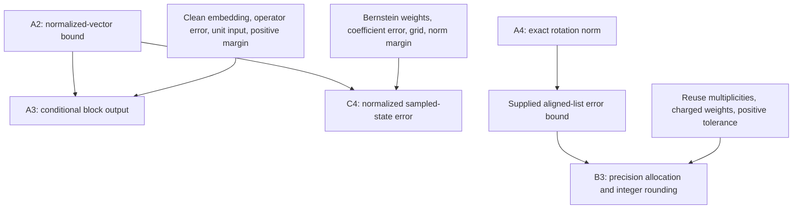

# Graph scope and mathematical reuse

This cohort uses frozen snapshot `qcb-snapshot-ffa644f0da3031a1ce754b9a`, whose
source commit is `86b9e677566498da04faebcf4e5ed57f177c6bb1`. Its current-reader
baseline is main `6b23dab68c2970062ddfd568ce94bce74b566483`. The coverage audit
records matching source bytes at both commits. The graph supplies stable
definitions and provenance; the authored proofs supply the claimed mathematical
dependencies.

| Relation | Meaning in this package | Evidence boundary |
| --- | --- | --- |
| Suggested reading | A useful source or related exercise | Does not discharge an obligation |
| Module import / declaration ownership | Where a definition is available or declared | Not an extracted theorem-proof dependency |
| Conceptual Functor Hypergraph transport | A conditional route such as block encoding to state preparation | Every AND premise and failure boundary remains necessary; no certified functor is claimed |
| Authored reasoning dependency | An explicit mathematical step consumes stated assumptions and earlier conclusions | Checked by NL derivation and substantive review; not a new Lean certificate |
| Supplied task obligation/interface | A theorem or bound explicitly provided in the question | Grading tests its use and premises, not an unrequested proof |

The following diagram records cross-packet reuse. Every node with several inputs
requires all of them. Each payload expands its own dependencies into claims,
assumptions, required inputs, conclusions and justifications.

`A2` is a shared provider for two different consumers. In A3, the raw error and
positive-overlap branches meet before normalization and the success interval.
In C4, the coefficient-to-sample-error branch meets the independent lower-norm
promise before the same normalization interface applies. Supplying that interface
in both questions makes the reuse visible and avoids requiring a hidden answer
from a different split. It does not make those two assessments statistically
independent of the provider.

The aligned-list error theorem already appears in the library and in the legacy
diagnostic `breadth-hermite-angle-budget`. It is supplied in B3. The newly assessed
work is optimizing a stated precision model for parameters reused with different
multiplicities, then proving integer rounding preserves the error budget. Neither
the cost model nor an angle-error assumption produces a finite-bit compiler.

The C2/C3 tensor-train slices have left-bond rows and right-bond columns and
multiply in head-to-tail word order. B1's sequential transfer matrices instead
have output rows and input columns, so the latest emitted stage multiplies on
the left. These orientations require an explicit adapter, not a silent matrix
identification. C2 changes internal coordinates; C3 derives a cross
environment and its Gram specialization; B4 transports word amplitudes to the
public little-endian sample convention. The use of a common interface makes
these compositions inspectable without asserting that all possible combinations
of graph nodes form meaningful questions.

Existing SP006, SP007 and LA015 refinements retain `test_public`; SP114 retains
`dev`. New candidates retain `unassigned_pending_reconciliation` and are packaged
for public review only. The overlap table records inherited train/dev/public-test
subproof relations. No part of this package authorizes pooling those fragments
as independent held-out evidence or moving a public-test solution into training.

A checked proposition alone is not a useful process reward: target alignment,
premise availability, progress toward the requested result and faithful
explanation remain separate judgments. D0 facets add no cores, and D1–D4 describe
the supplied construction route rather than model difficulty or graph distance.
